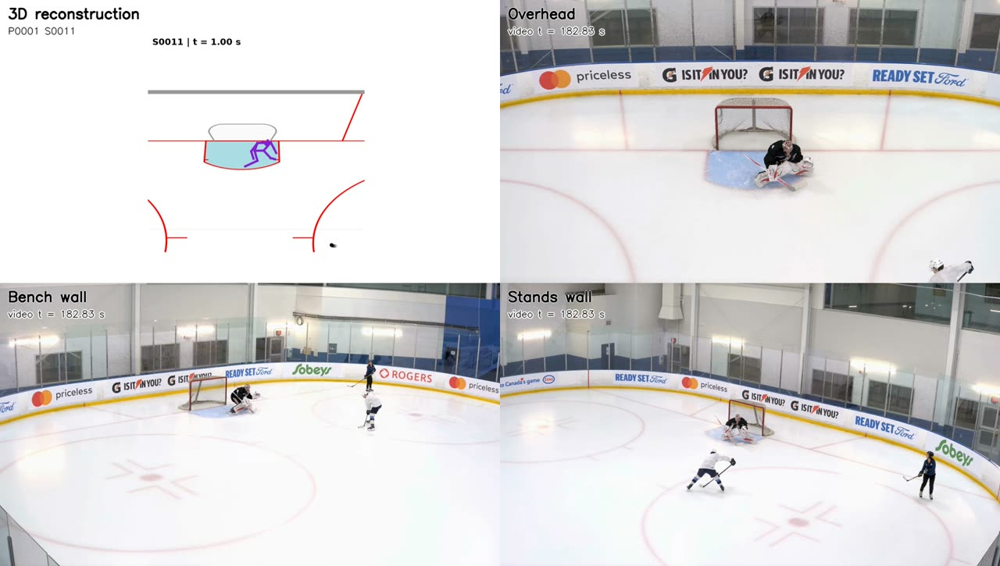
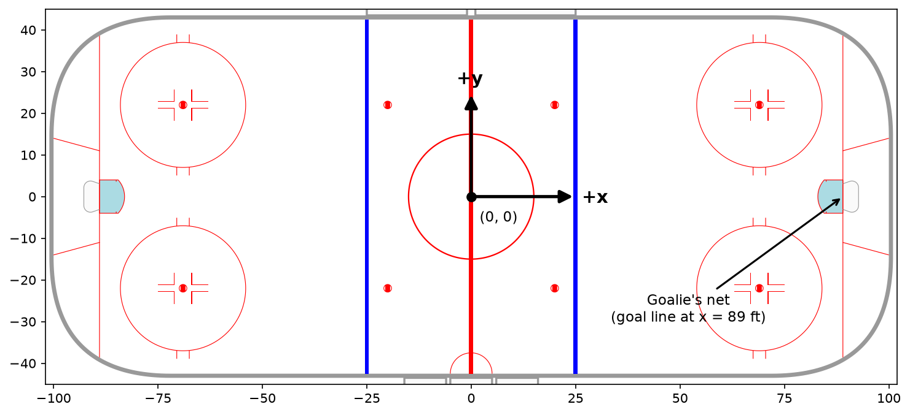
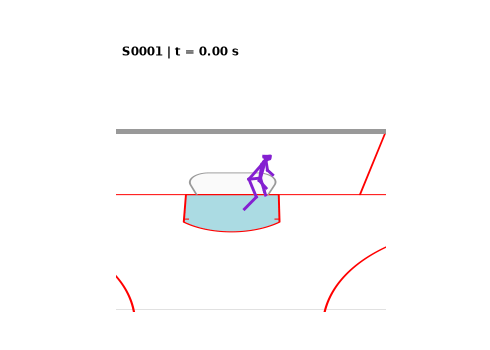

# SPL Hockey Goalie Dataset Documentation

*Last updated: November 2026*

## File structure

The shots are in the `data/` folder in the current directory, organized by session date and goalie. Each goalie has a **participant ID** (e.g. `P0001`), which stays the same across sessions. Shots are stored as JSON files with the naming convention `HK_GL_P0001_S000X.json`, where `P0001` is the participant ID and `X` is the shot ID. Shot IDs are increasing integers from `1` to the number of shots the goalie faced, in chronological order. Each shot file contains the 3D pose of the goalie and the 3D position and velocity of the puck, synchronized frame by frame.

Each JSON file has the following structure:

```
{
  "metadata": {
    "session_date": "2026-08-06",
    "participant_id": "P0001",
    "shot_number": "S0001",
    "duration__s": 7.333,
    "goalie_sampling_rate__hz": 60,
    "puck_sampling_rate__hz": 60
  },
  "tracking": [
    {
      "frame": 0,
      "time": 0,
      "data": {
        "puck": [x, y, z],
        "puck_velocity": [vx, vy, vz],
        "goalie": {
          "NOSE": [x, y, z],
          ...
        }
      }
    },
    ...
  ]
}
```

| Field | Description |
| :-- | :-- |
| `metadata.session_date` | Date of the session, `YYYY-MM-DD` |
| `metadata.participant_id` | Participant ID of the goalie, consistent across sessions |
| `metadata.shot_number` | Shot ID, in chronological order within the session |
| `metadata.duration__s` | Duration of the shot, in seconds |
| `metadata.goalie_sampling_rate__hz` | Sampling rate of the goalie pose data, in Hz |
| `metadata.puck_sampling_rate__hz` | Sampling rate of the puck tracking data, in Hz |
| `tracking` | List of frames, in chronological order |
| `frame` | Frame index within the shot, starting at `0` |
| `time` | Time since the first frame of the shot, in **milliseconds** |
| `data.puck` | `x`, `y`, `z` position of the puck, in **feet** (`null` if the puck was not detected) |
| `data.puck_velocity` | `x`, `y`, `z` velocity of the puck, in **feet per second** (`null` if not available) |
| `data.goalie` | `x`, `y`, `z` position of each goalie keypoint, in **feet** (`null` if not available) |

## Session Information

| Session | Goalies | Shots (total) | Sampling Rate | Usage
| :-: | :-: | :-: | :-: | :-:
| 2026-08-06 | 1 (P0001) | 81 | 60fps | [Stathletes Big Data Cup](https://stathletes.com/big-data-cup/data-documentation)

## Orientation video
To help orient yourself to the data, the video below shows shot `S0011` (`data/2026-08-06/P0001/HK_GL_P0001_S0011.json`) reconstructed from the JSON file using `animate_shot()` (top left), synchronized with the session's three camera views: overhead (top right), bench wall (bottom left), and stands wall (bottom right). Click the image to open the video.

<p align="center">
  <a href="./assets/orientation_video.mp4"></a>
</p>

## Coordinate system and Units

For the goalie pose keypoints and puck `xyz` positions, numbers are provided in **feet**, in accordance with the dimensions of an NHL rink.

The coordinate system is placed on the rink with the origin at center ice, as shown below:

<p align="center">
  
</p>

A few notes:
1. The `z` direction can be obtained using the right hand rule, pointing out of the screen in the above image, with `z = 0` at the ice surface.
2. All shots in this dataset were taken on the net on the positive `x` side of the rink, with the goal line at `x = 89` ft.

## Goalie tracking
Goalie tracking is provided through `x`, `y`, and `z` coordinates of 19 keypoints (see [Pose Markers](#pose-markers)), captured using the SPL markerless motion capture system. The keypoint positions were smoothed to reduce noise using a robust Savitzky-Golay filter (3rd-order polynomial, 11-frame window).

## Puck tracking
Puck tracking is provided through `x`, `y`, and `z` coordinates of the center of the puck, along with its velocity, from the Stathletes computer vision puck detection model.

**NOTE**: The puck is only tracked while it is detected by the camera, so puck data is `null` for parts of each shot (e.g. when the puck is hidden by the goalie or other players, or outside the camera's view). Each goalie frame is matched to the puck measurement closest in time (within 8 ms, i.e. half a frame); puck values are not interpolated.

## Pose Markers
The table below shows the goalie keypoints present in the dataset.

<center>

| Keypoint number | Keypoint name  | Description      |
|-----------------|----------------|------------------|
| 1               | NOSE           | Nose             |
| 2               | LEFT_EYE       | Left eye         |
| 3               | RIGHT_EYE      | Right eye        |
| 4               | LEFT_EAR       | Left ear         |
| 5               | RIGHT_EAR      | Right ear        |
| 6               | NECK           | Neck             |
| 7               | LEFT_SHOULDER  | Left shoulder    |
| 8               | RIGHT_SHOULDER | Right shoulder   |
| 9               | LEFT_ELBOW     | Left elbow       |
| 10              | RIGHT_ELBOW    | Right elbow      |
| 11              | LEFT_WRIST     | Left wrist       |
| 12              | RIGHT_WRIST    | Right wrist      |
| 13              | MID_HIP        | Mid hip (center) |
| 14              | LEFT_HIP       | Left hip         |
| 15              | RIGHT_HIP      | Right hip        |
| 16              | LEFT_KNEE      | Left knee        |
| 17              | RIGHT_KNEE     | Right knee       |
| 18              | LEFT_ANKLE     | Left ankle       |
| 19              | RIGHT_ANKLE    | Right ankle      |

</center>

## Animation
We provide basic utilities to animate goalie shots. We use the 3D rink plotting functions from the [mplhockey](https://pypi.org/project/mplhockey/) plotting library. To be able to use this functionality, you will have to install it using
```
pip install mplhockey
```
The `animate_shot()` function is defined in `animate.py`, and produces an animation like the one below:

```python
from animate import animate_shot

animate_shot("data/2026-08-06/P0001/HK_GL_P0001_S0001.json")
```



To save the animation as a video instead of displaying it in a Jupyter notebook:

```python
anim = animate_shot("data/2026-08-06/P0001/HK_GL_P0001_S0001.json", notebook_mode=False)
anim.save("S0001.mp4", writer="ffmpeg", fps=60)
```

### Camera options
The view can be changed using the `track_goalie`, `buffer`, `elev`, and `azim` arguments:

| Argument | Description |
| :-- | :-- |
| `track_goalie=True` (default) | Follows the goalie's `MID_HIP`, showing `buffer` feet on each side. Best for looking at goalie movement; the puck is only visible once it is near the goalie. |
| `track_goalie=False` | Fixed view covering the goalie and the full puck path, with `buffer` feet of padding. Best for seeing the whole shot; the goalie appears smaller. |
| `buffer` | For `track_goalie=True`: half-width of the view window in feet (e.g. `5` for a tight view of the goalie, `12` to see more of the puck approach). For `track_goalie=False`: padding around the goalie and puck path in feet. |
| `elev` | Elevation angle of the view, in degrees (`0` = ice level, `90` = straight down). |
| `azim` | Azimuth angle of the view, in degrees (`180` = from the slot looking toward the net, `270` = side view from the boards). |

Some example views:

```python
animate_shot(path, elev=30, azim=180)                # default: from the slot, looking toward the net
animate_shot(path, elev=50, azim=180)                # high view, similar to an overhead camera behind the shooter
animate_shot(path, elev=15, azim=270)                # side view from the boards
animate_shot(path, track_goalie=False, elev=90, azim=180) # top-down view of the full shot
```

Other options (colors, line widths, puck size, number of puck trail positions, and joint connections) are documented in the `animate_shot()` docstring.
